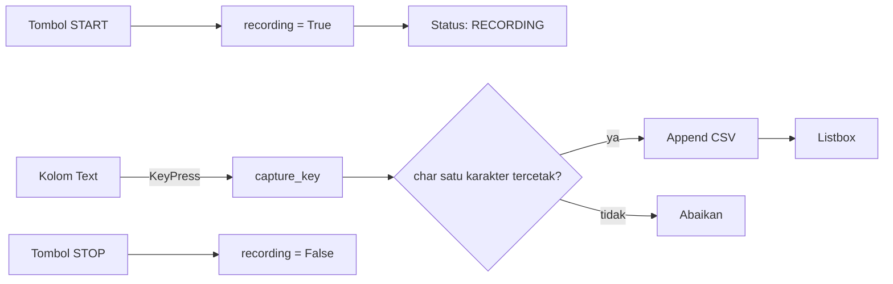

# Keylogger-Lab

[](https://www.python.org/)
[](https://docs.python.org/3/library/tkinter.html)
[](#jalankan)
[](#format-log)

Aplikasi Tkinter kecil yang merekam karakter yang diketik di dalam kolom teksnya sendiri dan menuliskannya ke `logs/keystrokes.csv` dengan timestamp.

> Perekaman terikat pada event `<KeyPress>` widget `Text` di jendela aplikasi ini. Tidak ada hook global, tidak ada koneksi jaringan, tidak ada dependency di luar Python stdlib.

---

## Daftar isi

- [Jalankan](#jalankan)
- [Alur](#alur)
- [Format log](#format-log)
- [Struktur kode](#struktur-kode)
- [Perilaku tombol](#perilaku-tombol)
- [Struktur folder](#struktur-folder)
- [Sebelum push](#sebelum-push)

---

## Jalankan

```powershell
cd Keylogger-Lab
python main.py
```

Membutuhkan Python 3 dengan modul `tkinter` tersedia. Tidak ada `pip install`, tidak ada virtual environment, tidak ada file konfigurasi.

Jendela berukuran `650x480`, tidak dapat di-resize, dengan judul **Python Keylogger Lab**.

---

## Alur



`capture_key` mengabaikan tombol kontrol dan apa pun yang bukan satu karakter tercetak. Setiap karakter yang lolos filter ditulis segera dengan `csv.writer`, lalu barisnya muncul di `Listbox`.

---

## Format log

Lokasi: `logs/keystrokes.csv`. Folder `logs/` dibuat otomatis saat modul diimpor.

```csv
2026-11-27 10:14:02,h
2026-11-27 10:14:02,e
2026-11-27 10:14:03,l
2026-11-27 10:14:03,l
2026-11-27 10:14:04,o
```

| Kolom | Contoh | Keterangan |
|---|---|---|
| `timestamp` | `2026-11-27 10:14:02` | `datetime.now()` dengan format `%Y-%m-%d %H:%M:%S` |
| `karakter` | `h` | `event.char`, satu karakter tercetak |

File dibuka dengan mode append, `newline=""`, dan encoding `utf-8`. Baris lama tidak ditimpa saat aplikasi ditutup lalu dibuka lagi.

---

## Struktur kode

| Bagian | Detail |
|---|---|
| `LOG_DIR`, `LOG_FILE` | `logs/`, `logs/keystrokes.csv`; `os.makedirs(..., exist_ok=True)` |
| `KeyloggerLab.__init__` | Inisialisasi `recording = False`, ukuran jendela, judul |
| `create_ui()` | Label judul `KEYLOGGER LAB`, label status, `Text` 9x65, frame tombol, `Listbox` 8x75 |
| `start_recording()` | Set `recording = True`, status hijau `RECORDING`, tulis notifikasi ke Listbox |
| `stop_recording()` | Set `recording = False`, status merah `STOPPED`, tulis notifikasi ke Listbox |
| `capture_key(event)` | Filter `event.char`, tulis CSV, tampilkan `f"{timestamp} | {event.char!r}"` |
| `clear_input()` | `delete("1.0", tk.END)` pada `Text`, tidak menghapus log |

Binding yang dipakai: `self.input_box.bind("<KeyPress>", self.capture_key)`.

---

## Perilaku tombol

| Tombol | Efek |
|---|---|
| **START** | Mulai merekam; status berubah dari merah ke hijau |
| **STOP** | Menghentikan perekaman; status kembali merah |
| **CLEAR** | Mengosongkan isi kolom teks; CSV tetap utuh |

Status awal adalah `● STOPPED` dengan warna merah. Teks pengujian diketik di kolom `Text` yang memakai font `Consolas 11`.

---

## Struktur folder

```text
Keylogger-Lab/
├── README.md
├── main.py
└── logs/
    └── keystrokes.csv
```

`logs/keystrokes.csv` dibuat saat runtime. Bila folder ini ikut di-commit, pastikan isinya sudah dikosongkan atau dimasukkan ke `.gitignore`.

---

## Sebelum push

| Item | Lokasi | Tindakan |
|---|---|---|
| `logs/keystrokes.csv` | `logs/` | kosongkan atau abaikan; isinya berasal dari sesi uji |
| `__pycache__`, `*.pyc` | root folder | tambahkan ke `.gitignore` |
| Path absolut | tidak ada | modul memakai path relatif terhadap working directory |

Jalankan dari folder `Keylogger-Lab` agar `logs/` dibuat di tempat yang diharapkan. Bila dijalankan dari folder lain, `LOG_DIR` mengikuti `current working directory`, bukan lokasi `main.py`.
